<h1 align="center"> Fault Line Echoes</h1>

《断层回声》是一款原创的第一人称页游。随项目开源的 skill 可以让你从自己的游戏点子出发，和 agent 一起把它做成能玩的世界。

<a href="README.md">English</a> · <a href="https://fault-line-echoes.vercel.app/">在线试玩</a> · <a href="https://fault-line-echoes.vercel.app/world-skill.html#zh">获取中文版 skill 指南</a> · <a href="https://fault-line-echoes.vercel.app/faultline-local.html">单文件游戏</a>

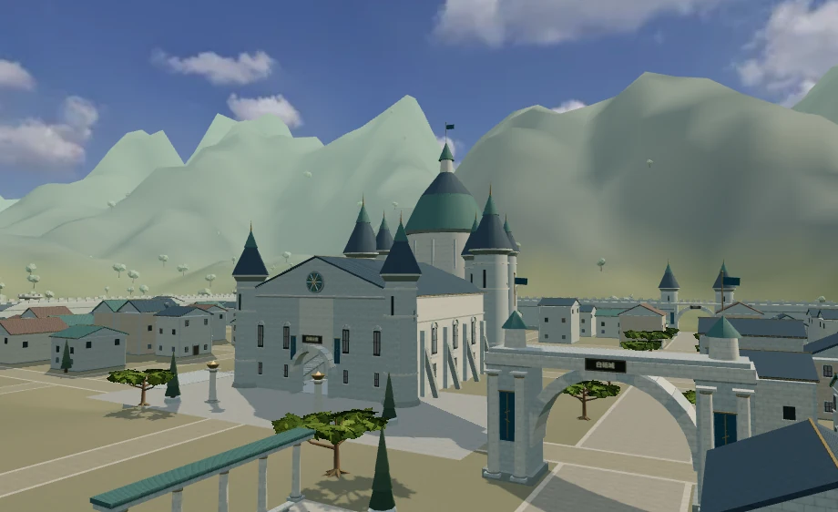

## 用 skill 构建你想玩的游戏

你可以直接用中文说清三件事：玩家要做什么、哪个选择有意思、选完后世界怎样改变。agent 会就影响玩法的取舍来问你，自己完成选型、建模接入、编程和试玩。游戏的地理、人物、冲突和后果从你的想法产生。比如要做停电期间的印刷铺，核心可以是仅够两期的纸和次日变化的读者来信。

**安装方法**：打开双语指南，点击「下载完整 skill」。解压后，把整个 `build-game-world` 文件夹放入新项目的 `.agents/skills/`。在 Codex 中打开该项目，新开对话，输入 `$build-game-world` 和你的游戏点子即可。克隆本仓库后，项目内已经包含这项 skill。指南本身也是单个 HTML，保存到本机后，断网也可以生成提示词、提取完整安装包。[打开使用指南](https://fault-line-echoes.vercel.app/world-skill.html#zh) · [skill 源文件](.agents/skills/build-game-world/SKILL.md) · [Git 中的单 HTML 指南](public/world-skill.html)

开头先选交付方式。你已选好时，agent 会直接沿用。

| 你的选择 | 玩家实际得到什么 |
| --- | --- |
| 单 HTML | 双击一个文件就能离线单机，程序、素材和物理模块随文件带走。更新时分享新版文件。 |
| 在线网址 | 玩家打开链接就能玩，刷新可获得更新。单机页游用静态托管即可，跨网络房间另需双方都能访问的服务。 |
| 两种都要 | 同一套游戏规则生成独立离线版和托管版。离线可玩单机，远程房间通过在线服务运行。 |

### 可以直接交给 agent 的提示词

**原创单机游戏**

> $build-game-world 做一个双击就能离线玩的印刷铺游戏。停电两天，纸只够印两期，我今天刊登的内容要改变明天的来信和候选稿件。让我看到纸还剩多少。做好后请走通两种不同的结果。

**原创合作世界**

> $build-game-world 我要离线单机和在线版。两位滑翔员要修一座漂移中的天文台，一人能辨气流，一人能固定活动平台。第一关可以冒险飞过短缺口，也可以修通远路。合作玩法有分歧时问我。请把任务做出来，再用两个浏览器验证双方看到的是同一次修复。

**完整复现示范游戏**

> $build-game-world 用内置的固定参考版本，在新目录复现《断层回声》。我需要单 HTML 和能开真实房间的网页版本。请验证分支任务、两名角色、双端创建和加入房间，再指出我可以从哪一处做自己的新地图。

skill 随附复现脚本和源码索引。agent 可以从本地 Git 仓库或 GitHub 取得固定版本。构建自己的项目时，可以单独借鉴河道、路由、物理和房间协议，再用你自己的设定编写任务因果和人物关系。[参考构建说明](.agents/skills/build-game-world/references/reference-build.md)

### 给专业角色美术和特效作者的协作窗口

**由于我不太懂得 3D 人物刻画，这里专门给专业创作者留了协作窗口。你依然可以通过这个 skill，把自己的角色和特效接进游戏。** 可以直接把交付文件夹或 ZIP 附给 agent，也可以告诉它工作区路径，再说一句「替换哪个角色，什么时候该看到这个效果」。

| 合作者交什么 | 最好附上 | agent 负责什么 |
| --- | --- | --- |
| 角色或皮肤的 GLB，或 glTF 加全部贴图 | 角色与皮肤名、单位和朝向、骨骼及动作名、参考姿势；有可编辑源文件也可附上 | 匹配骨骼与动作，校准第一人称双手和第三人称外形，检查换肤、穿模、施法和联机对方视角 |
| 腕饰、背包等挂件 | 目标骨骼或挂点、佩戴参考图、期望尺寸 | 对齐位置、旋转和缩放，检查各动作下的可见性 |
| 特效序列帧、网格动画或着色器和贴图 | 角色与技能、施放／命中／格挡事件、挂点、时长、帧布局、混合方式或参考视频 | 接入真实事件，确认落空和格挡有不同反馈，验证地面与高台、双端显示和性能 |

所有外部美术都请附署名和允许发行的授权范围。有美术文件和文字描述就能开始，agent 可以代填清单。

> $build-game-world 美术交付放在 `art-inbox/courier/`，里面是信使 GLB 和格挡火花图集。请给信使换上这件外衣，只有确认格挡成功时才在接触点出火花。按随附授权署名，分别实测普通命中和格挡，交回游戏内的对照图和可玩版本。

包里有顾潮真实的腕部听针模型和四帧格挡特效样片。脚本可以检查文件、引用贴图、模型节点和指定动画，最后还要进入游戏看实际动作。[美术交接说明](.agents/skills/build-game-world/references/art-handoff.md) · [可填写清单](.agents/skills/build-game-world/assets/handoff.example.json) · [完整交付样例](.agents/skills/build-game-world/assets/sample-delivery)

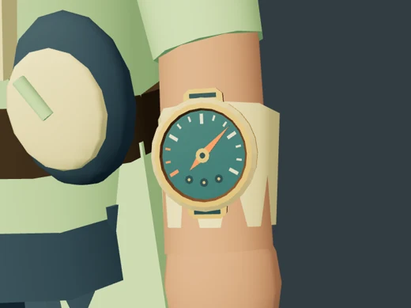

## 《断层回声》怎么玩

点首页「进入主城 · 白砥城」就会来到广场。你可以先去听铁匠打铁，或按 **T** 翻开任务手册。故事从一件小事展开：夜雨过后，闸钟比平时多响了一声。调度册上写着下游村落已经迁空，井绳上却还沾着今天的水。

### 白砥城和四境

大理石主城有议庭、药铺、铁匠铺、裁衣坊、包子铺、肉铺、客栈和泉井。居民会走街和返岗；取走有主物品时，目击者可能呼喊巡卫。四门距广场约 216 米，穿过整座城门的光幕会抵达另一地区的边境。四片野外地形各有约 1,240 米的跨度，可行走的空间包括地下、表面和上层。

| 西门 · 青雨林 | 东门 · 白盐旱漠 | 北门 · 古根丛林 | 南门 · 断潮峡谷 |
| --- | --- | --- | --- |
| 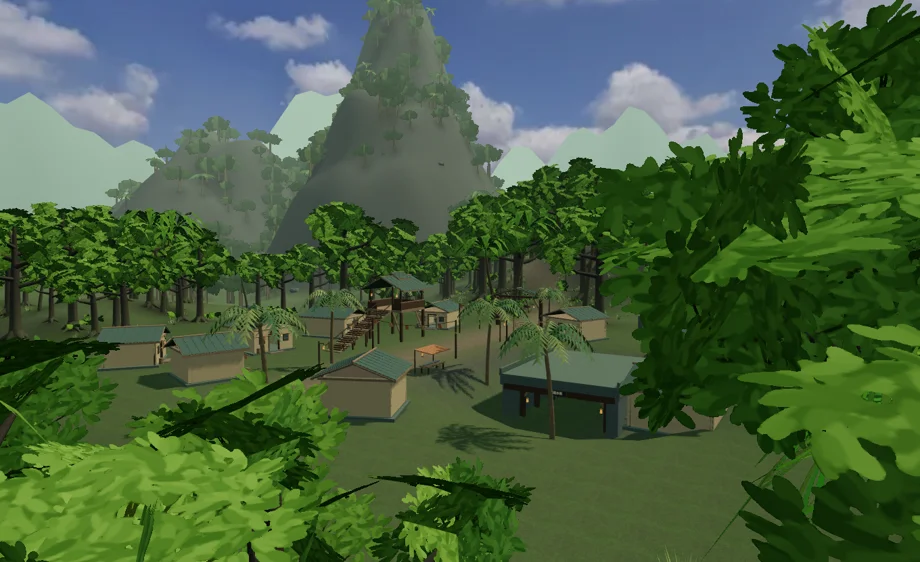 | 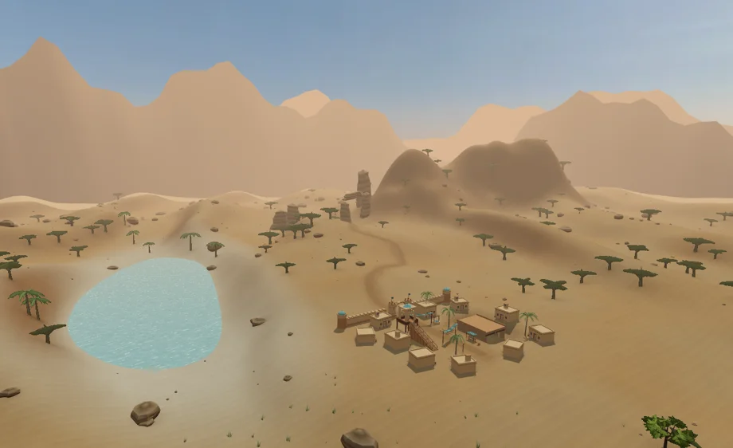 | 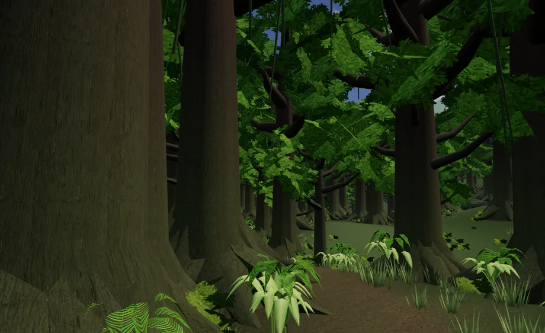 | 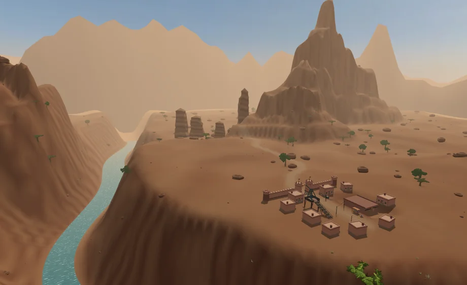 |
| 汇流镇、浅汊草滩、三叠跌水；古根山口通往古根丛林。 | 盐井、四风塔和背风坡；断潮山口通往峡谷。 | 登上千年冠廊，或走入中空根拱下的档案窟。 | 在维护渠、高架线和地下旁道之间寻找撤离路线。 |

### 四位行者

角色都空手出发，每人适配六套装束。在首页「行者」可以看身世、探索心得和技能图解。公平切磋使用默认角色属性，双方仍能看见对方的装束。

| 行者 | 出身与打法 | Q · E · C · V 和被动 |
| --- | --- | --- |
| 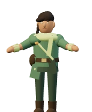 **叶岚** | 青雨林送汛报的巡线员，擅长找退路、借高差贴近。 | 穿步、折返、余波掌、断线。可前冲、后撤或隔空发掌；疾行后首击获得额外回响。 |
| 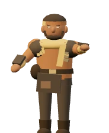 **许砾** | 前闸站检修工，近战防反，适合在窄口等对手交招。 | 沉肩、拨流、震台、合闸。突肩、限时招架、震地和近身终结；成功格挡的耐力代价较低。 |
| 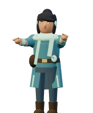 **顾潮** | 盆地测声员，佩戴「潮汐听针」，擅长在有开阔视线的地方压制对手。 | 直脉、折浪、退声、三拍。点射、分束、后撤施放或连续三次脉冲；远距命中获得额外回响。 |
| 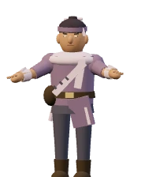 **陆衡** | 古根架桥师，惯于从桥脚读出通路，主打中距离控线。 | 扇潮、回折、锚步、槽涌。覆盖横向走位、集中射击或踏步进击；攻击衔接可加深硬直。 |

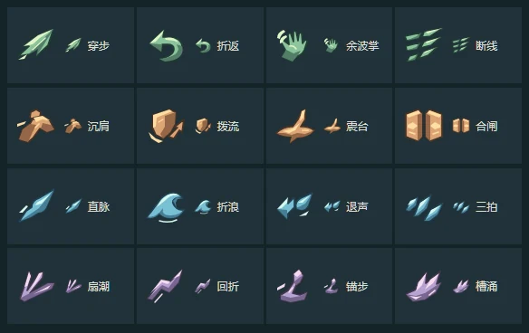

近战可以借墙和高低差缩短距离，轻重击与技能可以衔接。远程有真实飞行时间，射线会被实体掩体阻挡。施放、命中和格挡分别反馈，回响蓄满后才能放绝技。[十六招第一人称实景](docs/images/abilities.webp)

### 从接单一直走到交付

手册区分未接、已接和已完成。先选引导，再找到本人或镇里的委托牌接取。可以并行接单、切换追踪；目标在别区时，先引向正确的城门。

| 任务手册 | 白砥城序章实物 |
| --- | --- |
| 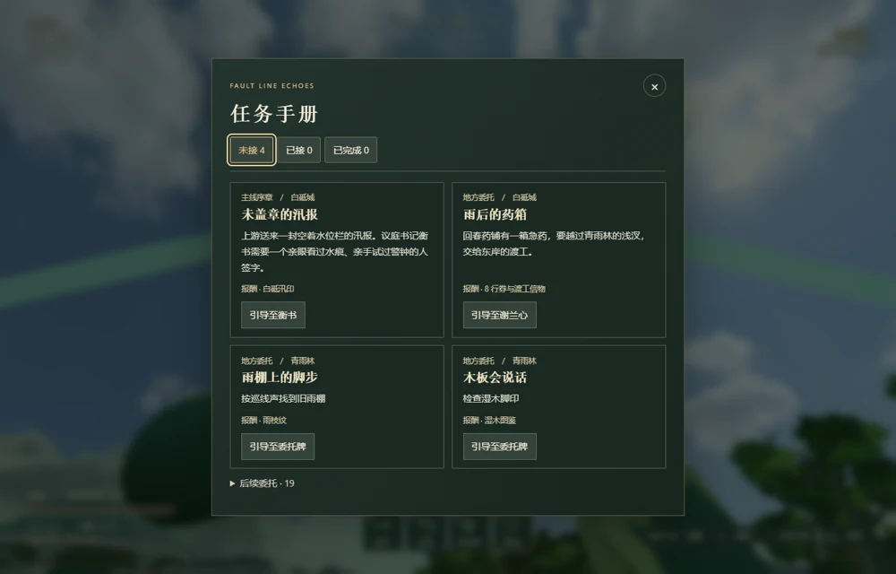 | 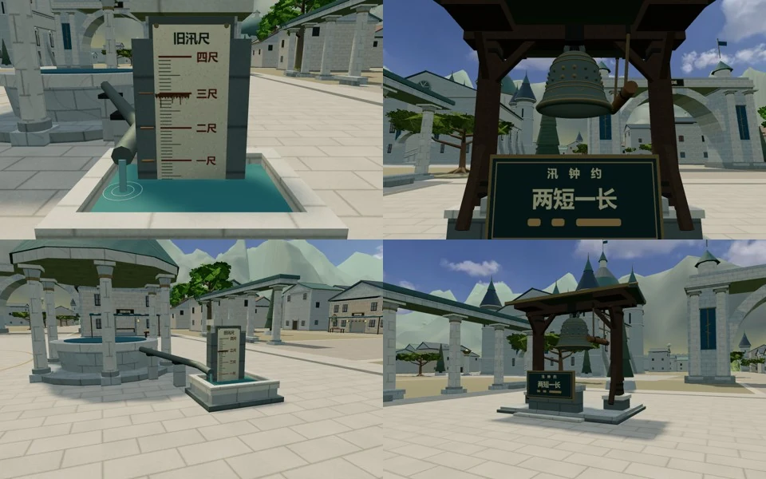 |

**「未盖章的汛报」** 从书记衡书那里接。去旧汛尺确认鲜泥痕，再照警钟铭牌试敲，回议庭盖印。序章接入九章主线：查证村民、核对名册、决定撤离路线，最后选择如何分流。十二条地方支线中埋着三条隐秘线索，战役共有三个结局。

**「雨后的药箱」** 从回春药铺的谢兰心接，留出 4 L 容量，背起药箱出西门。渡口可走近处的浅滩石脊，也可绕高岸木桥。未系牢的箱子掉进深水，会随水漂走；沿红系带追到下游，靠近按 **R** 捞回。出城前可以找裁衣师加固背带。交给东岸任舟可得八枚行券，追回落水药箱还会留下不同信物。

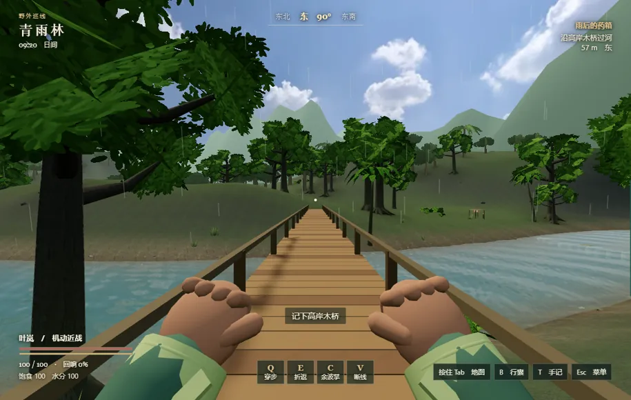

### 探索、生存和装备

- **行动和察觉。** 行走、疾跑、蹲伏、跳跃、游泳和攀爬都有对应动作与限制。石板、木桥、砂、林地和涉水的声音不同。按住静步键能压住脚步声，野兽仍有视野。失去目标时会搜索最后发现的位置，超过追击范围会返回。
- **饮食和歇息。** 负重、饮食、炎热和运动都会影响旅途。去包子铺领食物、到井边装水，野外可在炉火旁把水煮沸。客栈和驿站能歇到黎明或入夜，初次巡夜可向卫兵领取火把。
- **野怪和首领。** 四境有十三种普通动物、八种昼夜首领。06:00 至 18:00 为白昼。休息切换时段后，按住 Tab 看当前首领地点和线索。靠近倒下的动物按 R 逐份取材；肉、皮、壳甲各有出处。野牛肉可以烤熟，两份厚皮加细麻布能缝出 28 L 驮袋，盐母甲壳和螯护片可用于打制头盔。
- **行囊。** 初始容量 15 L，格子显示图标，实际按物品体积计量。可以检查来源和用途，吃喝、穿戴、交易、制作或放下。装备覆盖武器、头护、身护、腿护和鞋子。剧情、装备和待取物品保存在当前浏览器。

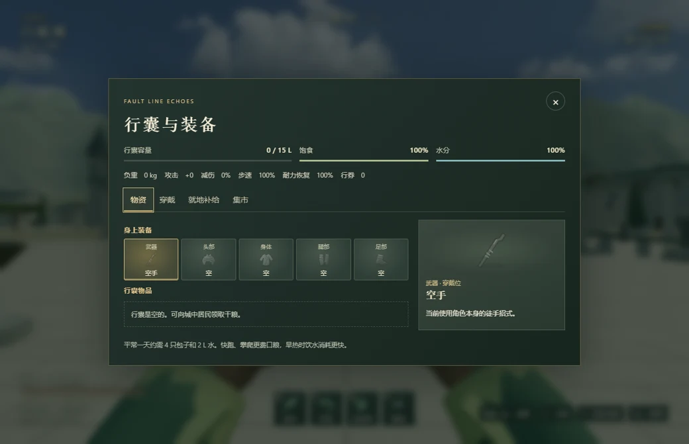

### 双人远程联机

首页点「联机」，房主选择切磋或合作巡线，创建房间并把六位房号或邀请链接发给朋友。邀请有效三分钟，配对后会话最长六小时，双方保持页面打开。切磋三局两胜、基础属性公平。合作巡线要求一人在听雨楼报声、另一人在废闸于 18 秒内确认；两人获得联测奖励，各自保留单机进度。[进入联机大厅](https://fault-line-echoes.vercel.app/?multiplayer=1)

房间先走同源 HTTPS 中转，能建立 WebRTC 时升级直连，直连中断后回落中转。房主判定命中、比分和协作结果。正式站使用 Vercel 区域 Runtime Cache，本地开发及预览使用相同协议的内存实现。完全断网可玩单机；单文件版也提供正式站入口和手动交换连接码的直连方式。

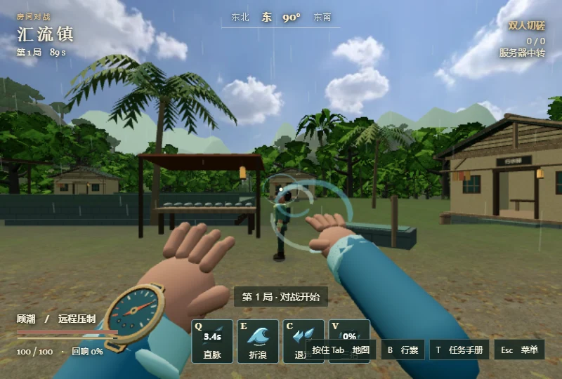

### 操作

| 操作 | 键位 |
| --- | --- |
| 移动、观察 | WASD、鼠标；方向键也可环视 |
| 轻击、重击、格挡 | 鼠标左键、X、按住 F |
| 技能、绝技 | Q／E／C、V |
| 疾跑、静步、蹲伏 | Shift、按住 Caps Lock、按住 Ctrl 或轻按切换 |
| 跳跃、攀爬 | 空格；面对够得着的抓点按住空格 |
| 交互、跨区 | R；直接穿过城门光幕 |
| 地图、行囊、手册 | 按住 Tab 看图、松开收起；B；T |
| 火把、菜单 | G、Esc |

## 本地运行、技术和引用

使用 Node.js 22.12+。执行 `npm ci` 安装依赖，`npm run dev` 开发，`npm test` 检查规则、剧情、地形、技能和房间。执行 `npm run build` 会生成网站和 `dist/faultline-local.html`，`npm run preview` 可启动带本地房间服务的生产预览。Vercel 从仓库根目录导入，沿用项目配置。Git 中也保存了[可双击的单 HTML 游戏](play/faultline-local.html)。运行 `npm run snapshot:game` 可以更新 Git 中的游戏快照。修改 skill 后，运行 `python scripts/package-world-skill.py` 重新生成便携指南与内嵌安装包。

| 内容 | 实现和来源 |
| --- | --- |
| 浏览器画面与模型 | Three.js（MIT）负责 3D 渲染和 GLB 加载。程序角色、骨架和服装实现在 `src/actors.js` 和 `src/avatar*.js`。顾潮听针由 [Python 源码](scripts/model-phase-dial.py) 生成，可用 Blender 继续修改。 |
| 物理与地理 | Rapier 3D（Apache-2.0）负责碰撞。山川地貌、水床水流、城门、居民作息和察觉实现在 `src/biomes.js`、`src/water-*.js`、`src/capital*.js`、`src/settlement*.js` 和 `src/people.js`。 |
| 故事、声音与规则 | 世界观、人物、剧情和任务链均为本项目原创。对应 `src/story.js`、`src/handbook.js`、`src/medicine.js`、`src/audio.js`、`src/combat.js`。 |
| 构建和房间 | Vite 负责打包。Vercel Functions 和区域缓存支持房间 API。传输、协作和战斗判定在 `src/room*.js`、`src/patrol.js`、`api/`、`server/`。 |
| 外部美术素材 | 地表、树皮和两张天空全景来自 Poly Haven，采用 CC0。下方清单逐项列明原作者素材页和项目内的处理。文中的人物像和游戏截图取自本项目。 |

原创代码、程序美术和 skill 采用 MIT。构建会生成 `dist/licenses/third-party.md`，单 HTML 游戏也内嵌第三方声明。[项目许可证](LICENSE) · [地表素材明细](public/terrain-materials/CREDITS.md) · [天空素材明细](public/sky/CREDITS.md) · [Three.js](https://threejs.org/) · [Rapier](https://rapier.rs/) · [Vite](https://vite.dev/)

## 交流友链

[https://linux.do](https://linux.do)
